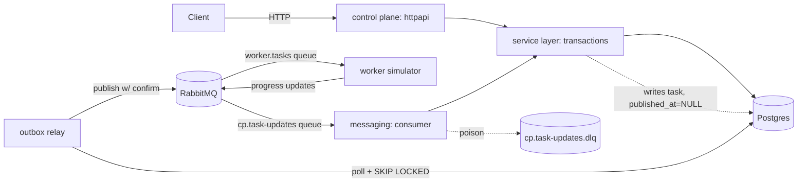

# DESIGN — Tenant Provisioning Control Plane

Source of truth for API shape, schema, state machines, and messaging contracts.
Read only the section you need for the current milestone.

## 1. Architecture



Layering (Ports and Adapters / hexagonal-lite):
- `domain` — pure Go, no I/O: state machines, slug rule, error codes, timestamp format.
- `store` — Postgres access (pgx), schema, tx helper.
- `service` — use cases; owns every transaction boundary.
- `httpapi` — HTTP adapter: routing, request/response mapping, error envelope.
- `messaging` — AMQP adapter: connection lifecycle, topology, publisher, consumer.
- `outbox` — the relay loop bridging `store` → `messaging`.

## 2. Data model

```sql
-- tenants: rows are NEVER deleted. "destroyed" is a terminal status, not a row removal.
-- This is how slug uniqueness "including against destroyed tenants" falls out for free.
CREATE TABLE tenants (
    id          uuid PRIMARY KEY,
    slug        text NOT NULL UNIQUE
                  CHECK (slug ~ '^[a-z][-a-z0-9]{1,26}[a-z0-9]$'),
    name        text NOT NULL CHECK (btrim(name) <> ''),
    status      text NOT NULL CHECK (status IN
                  ('provisioning','active','updating','destroying','destroyed','failed')),
    version     bigint NOT NULL DEFAULT 1,
    created_at  timestamptz NOT NULL DEFAULT now(),
    updated_at  timestamptz NOT NULL DEFAULT now()
);

-- tasks: the task IS the outbound event. published_at IS NULL means "not yet relayed".
CREATE TABLE tasks (
    id           uuid PRIMARY KEY,
    tenant_id    uuid NOT NULL REFERENCES tenants(id),
    type         text NOT NULL CHECK (type IN ('deploy','update','destroy')),
    status       text NOT NULL CHECK (status IN ('accepted','in_progress','done','failed')),
    error        text,
    created_at   timestamptz NOT NULL DEFAULT now(),
    updated_at   timestamptz NOT NULL DEFAULT now(),
    published_at timestamptz
);
CREATE INDEX tasks_unpublished_idx ON tasks (id) WHERE published_at IS NULL;

-- Invariant safety-net, NOT the concurrency mechanism (the service guards are):
-- at most one open task per tenant.
CREATE UNIQUE INDEX tasks_one_open_per_tenant
    ON tasks (tenant_id) WHERE status IN ('accepted','in_progress');

-- Inbox: idempotency ledger for inbound worker-progress messages.
CREATE TABLE processed_messages (
    message_id   text PRIMARY KEY,
    task_id      uuid NOT NULL,
    processed_at timestamptz NOT NULL DEFAULT now()
);
```

Timestamps render as `2006-01-02T15:04:05.000Z` (ISO-8601, ms, `Z`) via a small
`domain.Timestamp` JSON marshaller — Go's default `time.Time` JSON uses RFC3339 with
variable fractional digits and a `+00:00` offset, neither of which matches the brief.

## 3. State machines (table-driven, in `internal/domain`)

**Task** — forward-only by rank, not by an explicit from→to table:

| status | rank |
|---|---|
| accepted | 0 |
| in_progress | 1 |
| done | 2 (terminal) |
| failed | 2 (terminal) |

An inbound update applies **iff** `rank(new) > rank(current)`. This single rule gives
idempotency (`rank(x) > rank(x)` is false) and order-tolerance (a reordered lower-rank
update is rejected) in one line, and allows `accepted → done` directly if `in_progress`
was dropped or delayed.

**Tenant** — driven by API calls (guards below) and by terminal task outcomes:

| from | event | to |
|---|---|---|
| (none) | `POST /tenants` | provisioning |
| provisioning | deploy task done | active |
| provisioning | deploy task failed | failed |
| active | `PATCH` | updating |
| updating | update task done | active |
| updating | update task failed | failed |
| active, failed | `DELETE` | destroying |
| destroying | destroy task done | destroyed |
| destroying | destroy task failed | failed |

`CanUpdate(status)` = `status == active`. `CanDelete(status)` = `status in {active, failed}`.

## 4. HTTP API

| Method | Path | Success | Notes |
|---|---|---|---|
| POST | `/v1/tenants` | 201 + `Location` | body `{slug, name}` |
| GET | `/v1/tenants` | 200 | `?status=&limit=&cursor=` |
| GET | `/v1/tenants/{id}` | 200 | readable even when `destroyed` |
| PATCH | `/v1/tenants/{id}` | 202 | body `{name, version}`; `version` required |
| DELETE | `/v1/tenants/{id}` | 202 | |
| GET | `/v1/tenants/{id}/tasks` | 200 | sub-resource, not a query param |
| GET | `/v1/tasks` | 200 | `?status=&type=&limit=&cursor=` |
| GET | `/v1/tasks/{id}` | 200 | |
| GET | `/healthz` | 200/503 | checks DB + broker |

Mutating responses: `{"tenant": {...}, "task": {...}}`.
POST is 201 because the tenant exists synchronously at response time. PATCH/DELETE are
202 because they only *start* async work; the tenant's status in the response body
already shows `updating`/`destroying`, so the client isn't guessing.

### Error envelope

```json
{"error": {"code": "tenant_version_conflict", "message": "...", "details": {}, "request_id": "..."}}
```

| code | HTTP status |
|---|---|
| `tenant_not_found`, `task_not_found` | 404 |
| `tenant_already_exists` | 409 |
| `tenant_update_not_allowed` | 409 |
| `tenant_version_conflict` | 409 |
| `validation_error` | 422 |
| `malformed_request` | 400 |
| `internal_error` | 500 |

Pagination: keyset on the UUIDv7 `id` (time-ordered), `?limit=&cursor=<opaque id>`.
No `OFFSET` — avoids the classic page-drift-under-writes problem.

## 5. Concurrency (the NFR-1/NFR-2 mechanism)

**Create (slug race):** rely on the DB, not an app-level lock.
```sql
INSERT INTO tenants (...) VALUES (...);  -- unique violation (pg code 23505) on duplicate slug
```
Catch `23505` → `tenant_already_exists`. Whichever INSERT commits first wins; Postgres's
own MVCC + unique index serializes this. No `SELECT ... then INSERT` race window exists
because there's no read-then-write gap — the constraint is the arbiter.

**Update/Delete (version race):** one conditional UPDATE, not read-then-write:
```sql
UPDATE tenants
SET name = $name, status = 'updating', version = version + 1, updated_at = now()
WHERE id = $id AND version = $version AND status = 'active'
RETURNING *;
```
Two concurrent requests with the same `version` both execute this statement; Postgres
row-level locking means only one can match `version = $version` (the other sees the
already-incremented row and matches zero rows). Zero rows back → re-read the row and
disambiguate the **reason**, in this order: missing → `tenant_not_found`; wrong status →
`tenant_update_not_allowed`; otherwise (status ok, version differs) →
`tenant_version_conflict`. DELETE is the same shape with `status IN ('active','failed')`.

## 6. Messaging

### Outbound: Transactional Outbox (ADR-style decision, see §8 row 2)

The request transaction INSERTs the task row with `published_at = NULL`, writes the
tenant row, and **commits**. A separate relay loop then:
```sql
SELECT * FROM tasks WHERE published_at IS NULL ORDER BY id LIMIT 100 FOR UPDATE SKIP LOCKED;
```
publishes each with **publisher confirms**, and on ack sets `published_at = now()` in the
same transaction. `SKIP LOCKED` lets multiple control-plane replicas run the relay
safely without double-publishing. If the process crashes between confirm and commit, the
task is republished on restart — at-least-once, never at-most-once, never before commit.

Wire format (exchange `cp.tasks`, routing key `task.<type>`, queue `worker.tasks`, quorum):
```json
{"schema_version": 1, "id": "...", "type": "deploy", "tenant_id": "...", "status": "accepted",
 "created_at": "...", "tenant": {"slug": "...", "name": "..."}}
```

### Inbound: Idempotent Consumer + Inbox

Update message (exchange `cp.task-updates`, routing key `task.update.<status>`, queue
`cp.task-updates`, quorum, `x-delivery-limit=5`, DLX → `cp.task-updates.dlq`):
```json
{"schema_version": 1, "message_id": "...", "task_id": "...", "tenant_id": "...",
 "status": "done", "occurred_at": "...", "error": {"reason": "..."} }
```
`message_id` is **deterministic**: `UUIDv5(task_id + "/" + status)`. A worker retry or a
broker redelivery of the *same* logical update produces the same key, which is what the
brief means by "a stable identifier suitable as an idempotency key."

`ApplyTaskUpdate` (one DB transaction, lock order **tenant → task** — same order the API
path uses, which is what prevents a deadlock between the two):
1. `INSERT INTO processed_messages (message_id, task_id) VALUES (...) ON CONFLICT DO NOTHING`.
   Zero rows affected = duplicate → commit, ack, done. **(Idempotent.)**
2. Look up the task's `tenant_id`. Unknown task → permanent error (poison, see §7).
3. `SELECT ... FOR UPDATE` tenant, then task.
4. If the task is already terminal, or `rank(new) <= rank(current)`: log as stale,
   commit (the inbox row stands), ack. **(Order-tolerant — no regression.)**
5. Otherwise update the task row. If the new status is terminal, also update the tenant
   (`version + 1`, guarded on the expected in-flight status) per the mapping in §3.

### Resilience

| Failure | Handling |
|---|---|
| Decode/schema error | `Nack(requeue=false)` → DLQ; consumer keeps running |
| Unknown `task_id` | `Nack(requeue=false)` → DLQ (poison, not transient) |
| Recovered panic in handler | `Nack(requeue=false)` → DLQ |
| Transient DB error (connection blip) | bounded in-process retry w/ backoff, then `Nack(requeue=true)` |
| Redelivery loop | capped by queue's `x-delivery-limit=5`, then dead-lettered automatically |
| AMQP connection drop | connection manager watches `NotifyClose`, reconnects w/ backoff+jitter, re-declares topology (idempotent), resumes |

## 7. Decisions table (replaces separate ADR files)

| # | Decision | Alternative considered | Why this one |
|---|---|---|---|
| 1 | Go + Postgres + RabbitMQ | Python/Kafka | Go's explicit concurrency fits conditional-UPDATE + goroutine consumer; Postgres unique/partial indexes do the hard invariant work for free; RabbitMQ's per-message ack + DLX is simpler to reason about than Kafka offsets for poison-message handling |
| 2 | Transactional Outbox (task table doubles as the outbox) | Publish inside the request / 2PC | 2PC needs an XA-capable broker (RabbitMQ isn't); publishing in-request risks "publish then crash before commit" or "commit then crash before publish" — outbox makes "after commit, never on rollback" structural, at the cost of relay latency (sub-second here) |
| 3 | Idempotency via deterministic `message_id` + inbox table | Rely on broker dedup | Brokers don't guarantee dedup under at-least-once; a dedicated `processed_messages` table with `ON CONFLICT DO NOTHING` is explicit, DB-transactional with the state change, and auditable |
| 4 | Order-tolerance via status rank, not a from→to table | Track "last seen status" separately | One comparison (`rank(new) > rank(current)`) covers both idempotency and staleness; a from→to table would need an explicit self-loop and reordering case per status |
| 5 | Optimistic locking via conditional UPDATE, not SELECT-then-UPDATE | App-level mutex / advisory lock | A single statement is race-free by construction; advisory locks add an extra round trip and a lock-management surface for no extra safety here |
| 6 | Slugs tombstoned (rows never deleted) | Hard delete + separate "taken slugs" table | The brief requires uniqueness against destroyed tenants; keeping the row makes the existing `UNIQUE(slug)` constraint cover that case with no extra table |
| 7 | UUIDv7 ids + keyset pagination | Serial ids + OFFSET | UUIDv7 is time-ordered, so `id` alone is a valid keyset cursor; OFFSET pagination drifts under concurrent writes |
| 8 | Desired-state write on PATCH (`name` updates immediately, `status` tracks reconciliation) | Only flip status, apply name after task completes | Matches how a human caller expects "update" to behave (the request is accepted and recorded now); mirrors k8s spec/status and Capella's config vs. deployment-status split — see PRD.md §7 |

## 8. Failure-mode matrix (quick reference for the walkthrough)

| Crash point | Outcome |
|---|---|
| Between tenant/task INSERT and commit | Rollback — no tenant, no task, no event. Client sees 5xx, can retry safely (slug not yet claimed... unless commit actually succeeded, in which case retry hits `tenant_already_exists`, which is correct). |
| Between commit and outbox publish | Relay republishes the unpublished task on the next poll/restart. At-least-once. |
| Between publish confirm and marking `published_at` | Same as above — worst case is a duplicate delivery to the worker queue, which the worker/consumer side must already tolerate. |
| Worker crashes mid-task | Task message is unacked → requeued by the broker → another worker (or the same one, restarted) picks it up. |
| Consumer crashes mid-`ApplyTaskUpdate` | Transaction rolls back; message was never acked; redelivered; inbox INSERT ensures no double-apply. |
| Duplicate/stale/malformed inbound message | Handled per §6 Inbound / §6 Resilience — no regression, no crash. |
